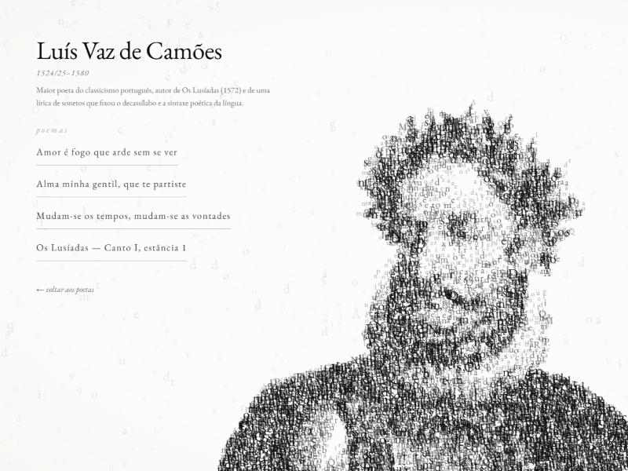
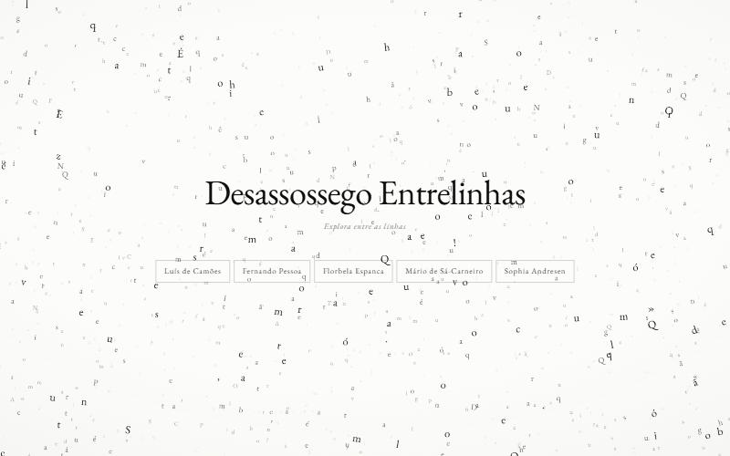
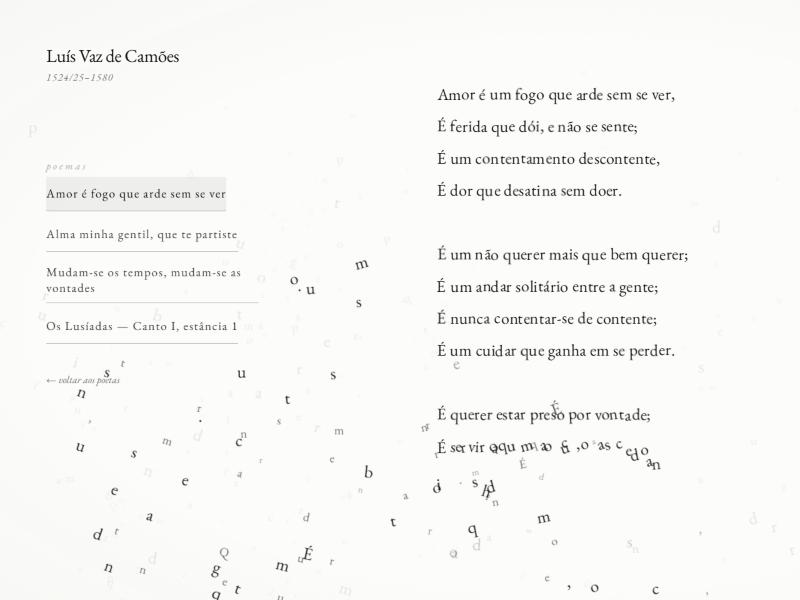

# Desassossego Entrelinhas

Os rostos da poesia portuguesa compostos pelas letras das suas próprias obras.

**[desassossego-entrelinhas.vercel.app](https://desassossego-entrelinhas.vercel.app)**



Milhares de glifos tipográficos navegam um campo de correntes, inclinando-se
na direção em que vão. Ao escolher um poeta agrupam-se e desenham-lhe o rosto
a partir de uma fotografia; ao escolher um poema viajam para uma grelha e
escrevem-no, verso a verso, enquanto as letras que ainda não têm lugar saem da
frente. O cursor abre buracos no campo, como se afastasse pó.

Não há uma única imagem desenhada: tudo o que se vê é tipografia. E não é
tipografia qualquer — as letras que compõem o rosto de um poeta são as letras
que ele escreveu, na proporção em que as escreveu.

Cinco poetas, catorze poemas, nenhuma dependência. HTML, CSS e JavaScript sem
andaimes: nada a instalar, nada a compilar.

---

## Os três estados

**O campo.** Enquanto ninguém escolheu, as letras flutuam em correntes lentas
e de vez em quando reconhecem-se e formam uma palavra, que passados uns
segundos se desfaz.



**O poema.** As letras viajam para uma grelha e escrevem-no verso a verso. As
que não lhe pertencem deixam de ser desenhadas por cima do texto, e vê-se o
poema a fazer-se com o resto do campo ainda a chegar.



---

## Como pôr a correr

```bash
python servir.py
```

e abrir **http://localhost:5173**.

### Porque é que não basta abrir o index.html

Não é teimosia do código — é como os browsers funcionam. No protocolo
`file://` acontecem duas coisas, as duas fatais:

1. Os módulos de JavaScript são pedidos em modo CORS e bloqueados. O site nem
   chega a arrancar.
2. Desenhar uma fotografia local num canvas contamina-o, e o `getImageData`
   que lê os píxeis do retrato passa a lançar `SecurityError`. É assim no
   Chrome, no Firefox e no Safari, e não há opção que o contorne.

Qualquer servidor de HTTP resolve as duas. O `servir.py` que vem na pasta faz
mais uma coisa útil: manda os ficheiros sempre sem cache, para que ao gravar
um CSS e recarregar se veja a alteração e não a versão de há cinco minutos.

Alternativas, se preferires:

```bash
npx --yes serve@14.2.4 . -l 5173
```

---

## O que está aqui dentro

```
index.html                 o documento, e a antologia completa em texto
servir.py                  servidor de desenvolvimento, sem cache
vercel.json                cabeçalho de cache para os retratos
LICENSE                    MIT para o código; o conteúdo à parte
assets/images/             os cinco retratos, 700×700, a preto e branco
docs/                      as imagens deste ficheiro
styles/                    sete folhas, carregadas em paralelo
scripts/
  main.js                  arranque e ligação ao mundo exterior
  core/                    matemática, aleatoriedade, ambiente, relógio, eventos
  particles/               atlas de glifos, física, enxame, desenho
  targets/                 o que transforma imagens e texto em destinos
  data/library.js          lê a antologia a partir do DOM
  states/                  a encenação e as palavras que se formam
  ui/                      navegação e luz circadiana
```

---

## Decisões que vale a pena conhecer

**Os poemas estão no `index.html`, não num ficheiro de dados.**
O motor lê-os de lá (`scripts/data/library.js`). Há uma única fonte de
verdade, e o que se vê no canvas é literalmente o mesmo texto que um leitor de
ecrã lê. Sem JavaScript — por opção, por erro de rede, ou porque o Firefox com
`resistFingerprinting` degrada o `getImageData` — o site continua a ser o que
diz ser: uma antologia de poesia portuguesa. **Para acrescentar ou corrigir um
poema, edita o HTML.** O formato está documentado no topo do `library.js`.

**O campo é texto desfeito, não um alfabeto.**
As letras que flutuam não são sorteadas do alfabeto: são tiradas dos versos,
com as repetições que lá estão. Enquanto ninguém escolheu um poeta, o campo é
feito da antologia inteira; a partir de uma escolha, é feito da obra daquele
autor — as mesmas letras que lhe compõem o rosto são as que continuam a voar
por trás dele. E não se repõem ao voltar atrás: quem sai de um retrato deixa o
campo vestido com as letras daquele poeta, e é com elas que a página fica até
alguém escolher outro.

A diferença mede-se. Sorteadas do alfabeto do atlas, cada mil letras no ecrã
traziam 358 maiúsculas, 200 sinais de pontuação e 83 algarismos — proporções
que não existem em nenhuma língua, e que davam ao campo o aspeto de um erro de
codificação. Tiradas dos versos, as mesmas mil trazem 883 minúsculas, 43
maiúsculas, 72 sinais e 2 algarismos: uma página de poesia desfeita em letras.

**Nada no JavaScript decide aparências.**
A única coisa que o motor escreve em DOM é `document.body.dataset.stage`, com
um de quatro valores — `intro`, `home`, `poet`, `poem` — e um número na
variável `--warmth`. Todo o resto é consequência declarada em
`styles/main.css`. Se quiseres mudar o que se vê em cada etapa, é lá.

**A entrada é escrita, não exibida.**
A saudação é partida em letras, e cada uma aparece e sai com o seu atraso, da
esquerda para a direita — uma frase a ser dita, não um bloco a ligar-se. O
único número que o JavaScript escreve é o índice de cada letra; a duração, a
curva, quanto sobe e quanto espera estão todos em `intro.css` e em
`variables.css` (`--intro-stagger`, `--intro-letter`). Para mudar o texto,
`index.html` — e muda-se também o `aria-label`, que é o que um leitor de ecrã
ouve em vez de onze letras soletradas.

**A entrada é a página de carregamento.**
A palavra de boas-vindas só sai do ecrã quando o site estiver pronto: a
tipografia descarregada, o atlas de glifos rasterizado e os cinco retratos já
analisados. Por isso escolher um poeta é instantâneo — a nuvem de pontos foi
calculada enquanto a palavra estava parada. A espera tem teto de seis
segundos, para que um CDN em baixo não transforme a entrada na página final.

**Os tokens mandam, incluindo no canvas.**
As cores, os corpos de letra, as opacidades, as durações e os quatro planos de
profundidade estão todos no `:root` de `styles/variables.css`. O motor lê-os
de lá no arranque. Mudar `--layer-3-size` muda mesmo o desenho.

**A paleta está preparada para pastéis, a sério.**
É monocromática por decisão, mas todo o texto secundário do site — notas,
anos, legendas, metadados, botões em repouso — passa por `--accent-1`,
`--accent-2` e `--accent-3`, e não pelos tons de tinta diretamente. Mudar
essas três linhas repinta o site inteiro. A diferença entre isto e um token
de acento que ninguém consome é que este prepara mesmo alguma coisa.

**Direito de autor.**
Camões, Sá-Carneiro, Florbela Espanca e Fernando Pessoa estão em domínio
público. Sophia de Mello Breyner Andresen morreu em 2004 e a obra dela só
entra em domínio público a 1 de janeiro de 2075 — por isso não há aqui um
único verso seu. O retrato fica, e o site explica a ausência. O rosto dela é
composto com as letras dessa própria explicação.

Os textos foram transcritos de fac-símiles das primeiras edições e cruzados
verso a verso com fontes independentes. Cinco levaram correções nesse
processo, entre elas o primeiro verso de Camões — **"Amor é _um_ fogo que arde
sem se ver"**, com o artigo que a maior parte das páginas online omite e que
sustenta a anáfora do soneto — e o de Florbela, que leva "Ser _poeta_" em
minúscula no verso embora o título se grafe em maiúscula.

---

## Como mexer

### Acrescentar um poeta

1. Pôr a fotografia em `assets/images/`, 700×700, a preto e branco, sujeito
   escuro sobre fundo branco puro. **Nome do ficheiro em minúsculas, sem
   acentos nem espaços** — o site vai ser publicado num servidor Linux, que
   distingue maiúsculas de minúsculas e não perdoa.
2. Acrescentar um `<article data-poet="..." data-years="..." data-image="...">`
   à antologia no `index.html`, a seguir aos outros. Copiar a estrutura de um
   que já lá esteja.
3. Mais nada. A navegação, o retrato e a lista de poemas constroem-se sozinhos.

Se o fundo da fotografia não for branco puro, o retrato sai espalhado pelo
retângulo todo. O amostrador deteta esse caso e avisa na consola.

### Afinar o desenho dos retratos

Em `scripts/targets/image-sampler.js`, no topo. Os dois números que mais
mudam o resultado:

- `DARKNESS_GAMMA` (0.78) — **abaixo de 1, de propósito.** Metade destas
  fotografias é preto absoluto: o chapéu de Pessoa e o casaco de Camões são
  massas chapadas, sem pormenor nenhum lá dentro. Com um expoente acima de 1,
  o chapéu recebia nove vezes mais letras por píxel do que a cara, e o
  resultado era uma mancha sólida com um buraco branco onde devia estar um
  rosto.
- `FLAT_CEILING` (0.6) — limita quantos pontos uma zona chapada pode
  requisitar. Cada ponto gasto a preencher um chapéu liso é um ponto que falta
  na cara.

O tom com que cada letra é desenhada é guardado à parte da decisão de onde
pôr os pontos. Separar as duas coisas é o que permite ter contraste de
tamanho — letras grandes nos pretos, pequenas nos claros — sem gastar o
orçamento todo nas sombras.

### Mudar as letras que andam no ar
O conjunto de cada autor sai dos poemas dele, no `index.html`: acrescentar um
poema muda o que flutua quando esse poeta está escolhido, sem mais nada a
fazer. Quem não tem poemas — por a obra estar protegida — empresta ao campo a
frase que explica a ausência.

Quem decide de quem são as letras é `letterField`, em
`scripts/states/director.js`; a troca propriamente dita é `reglyph`, em
`scripts/particles/system.js`. Uma letra só muda de identidade quando ninguém
a vê mudar: as que estão a desenhar um rosto ou um verso nunca mudam, as
invisíveis mudam já, e as que estão à vista mudam poucas por fotograma ao
longo de `RELETTER_SPAN` segundos — pouco mais de um, medido em 1,6% do campo
por fotograma. Encurtar esse tempo faz o campo cintilar na mudança.

### Afinar o movimento

`scripts/particles/physics.js`. Há dois regimes, e cada um tem o seu bloco de
constantes no topo do ficheiro:

- `SPRINGS` governa as partículas **presas** — as que compõem um rosto ou um
  verso. Parametrizadas por frequência angular e razão de amortecimento; a
  régua é que uma partícula criticamente amortecida assenta em cerca de
  `5.83/ω` segundos.
- `FLOW` governa as partículas **livres**, as que voam. `frequency` é a escala
  das correntes (0.0022 dá células de ~450 px, três ou quatro por ecrã),
  `timeScale` a lentidão com que o campo roda, e `steering` a inércia: baixo,
  a letra descreve curvas; alto, cola-se ao campo e o movimento fica mecânico.
  `tether` é a amarra, e existe por um motivo medido: um campo de correntes
  acumula partículas: ao fim de dois minutos havia zonas do ecrã vazias ao
  lado de zonas com sete vezes a densidade média. Cada letra tem por isso uma
  zona sua e uma mola fraquíssima — dezoito vezes mais lenta do que a que
  compõe um rosto — que a traz de volta ao fim de uma dezena de segundos. A
  variação de densidade caiu de 2.05 para 0.6 e nenhuma zona fica vazia.
  Subir a amarra iguala mais o campo e tira velocidade às letras; baixá-la
  faz o contrário.
- `TILT` é a inclinação. Uma letra que vai para a direita inclina-se para a
  esquerda, como quem corre contra o ar. À velocidade de cruzeiro dá uns onze
  graus; o máximo de dezanove fica para quando o cursor atira uma letra.

As palavras que se formam no campo estão em `scripts/states/words.js`: o
vocabulário, a frequência, quanto tempo ficam e com que força se abrem ao
desfazer-se. Têm plano próprio no atlas, com corpo maior do que qualquer
plano de profundidade (`--word-size`) — formadas no corpo das letras à volta,
perdiam-se: via-se letras a mexer, não uma palavra a formar-se.

A densidade do campo é `FIELD_DENSITY`, em `scripts/states/director.js`:
partículas por píxel quadrado de viewport. Não é o orçamento todo — esse é
dimensionado para a resolução que um ROSTO exige, e essa densidade num campo
aberto é uma parede de letras.

### Afinar a composição dos poemas

`--reading-*` no `variables.css`: corpo mínimo, máximo, confortável,
entrelinha, espacejamento e calha entre colunas.

O número de colunas não é escolhido pelo corpo de letra maior — era, e estava
errado. Um soneto tem dezassete linhas com as brancas, cabe numa coluna a 19
píxeis e cabia em duas a 21, por isso a regra do corpo maior partia todos os
sonetos ao meio. Um soneto é 4-4-3-3; cortado a meio deixa de o ser, e dois
píxeis de corpo não pagam isso.

A regra é agora **o mínimo de colunas que dê um corpo confortável**
(`--reading-comfort`, 16px). Só quando nem duas colunas chegam ao conforto é
que se escolhe a repartição que dá o corpo maior — o caso do *Quase* e da
*Dispersão*, com quarenta versos. O corte é sempre entre estrofes.

Enquanto um poema se escreve, as letras que não lhe pertencem deixam de ser
desenhadas dentro da mancha do texto. Não há força nenhuma: elas continuam a
atravessar a página como sempre. A primeira versão EXPULSAVA-AS, com uma força
que as mandava para fora pela saída mais curta — e para uma letra no meio do
bloco a saída mais curta é para cima ou para baixo, ou seja, atravessando
todos os versos. Formava-se uma fila encostada ao texto e entulho entre as
letras do poema, exatamente o contrário do pretendido.

---

## Limites conhecidos

- **Um poema muito longo num ecrã baixo** fica composto no corpo mínimo e pode
  transbordar por baixo. O texto completo está sempre legível na antologia.
- **Em ecrãs estreitos**, a grelha do poema e o painel do poeta sobrepõem-se.
  O painel ganha uma auréola de papel por trás das letras, e as duas camadas
  lêem-se — é uma sobreposição assumida, não um acidente. Houve uma versão que
  empurrava o poema para a direita do painel: resolvia a sobreposição e
  trocava-a por um poema encostado ao terço direito do ecrã, com meia página
  vazia à esquerda. A grelha ficou centrada.
- **Os botões dos poetas só cabem numa linha acima de 54rem.** Abaixo disso
  voltam a quebrar: cinco nomes lado a lado num telemóvel exigiriam um corpo
  de letra que já ninguém lê.
- **A nuvem de cada rosto é calculada no browser**, o que a torna dependente
  do decodificador de imagem de cada motor. Em Chrome, Firefox e Safari o
  resultado é praticamente igual; num browser com proteção anti-impressão
  digital ativa, o retrato pode sair degradado. Nesse caso a antologia
  continua lá.
- **Os ícones ainda não existem** — o site não usa nenhum, por decisão: tudo
  o que é interativo é um botão de fio com uma palavra lá dentro.

---

## Publicar

É um site estático: não há passo de compilação, não há `package.json`, não há
nada a instalar. No Vercel, importar o repositório e deixar tudo por omissão —
*framework preset* em **Other**, sem *build command*, com o *output directory*
na raiz. O `vercel.json` só acrescenta uma coisa: os cinco retratos ficam uma
semana na cache do browser, por serem a parte pesada e a que nunca muda. Se
algum deles for substituído, quem já visitou pode ver o antigo durante esse
tempo.

O `servir.py` não é publicado (está no `.vercelignore`); fica no repositório
por ser útil a quem clona.

---

## Licença

O código — o HTML, o CSS, o JavaScript, o servidor — está sob licença MIT:
quem quiser pegar no motor de partículas que pegue, dando crédito. O conteúdo
é outra conversa, e está explicada no ficheiro `LICENSE`: os poemas em domínio
público são de quem os quiser, os retratos têm cada um o seu estatuto.

---

## Browsers

Chrome, Firefox, Safari e Safari em iOS. O `devicePixelRatio` é limitado a 2 e
a área do canvas tem teto, porque o Safari em iOS descarta canvas grandes em
silêncio — ficam brancos, sem erro nenhum na consola.

Com `prefers-reduced-motion` ativo a página não anima — mas continua a
funcionar por inteiro: abre com um rosto já composto, e escolher outro poeta
ou um poema compõe o novo estado de uma vez, sem viagem. Há também um botão
explícito para quem quiser ver o movimento.

As misturas de cor (`color-mix` em oklab) estão fechadas num `@supports`.
Abaixo do Chrome 111, Safari 16.2 ou Firefox 113, o papel deixa de aquecer ao
meio-dia e os botões deixam de responder ao cursor, mas o site fica inteiro e
com o mesmo aspeto a olho — que é mais do que acontecia antes, quando o papel
e os contornos simplesmente desapareciam.
